# Gridfinity for SolidCraft

A [SolidCraft](https://github.com/tangency-labs/solidcraft) plugin that makes
[Gridfinity](https://gridfinity.xyz) bins and baseplates, including baseplates that fill a drawer and
are split to fit your printer. The result is ordinary SolidCraft features:
one undo step, editable afterwards, and they keep working without the plugin.


| Underside: feet with magnet and screw holes | 4×3 baseplate with magnet holes |
|---|---|
|  |  |

- **bin**: width × depth cells, height in units (7 mm), Gridfinity feet, 0.95 mm walls,
  stacking lip, optional magnet holes (6.5 × 2.4 mm), screw holes (3 mm) and dividers.
  Full grid (42 mm cells) or **half grid** (21 mm cells: four feet fit one baseplate pocket; magnet
  holes sit on the same spots as a full-grid baseplate's magnets), or a **custom cell size**.
- **Custom grid** (`grid`: "Custom (sizes below)"): your own cell size from 15 to 100 mm, set
  separately along X and Y (`custom_size_x`, `custom_size_y`), so bins and baseplates divide evenly
  into a drawer or organizer. Parts with the same custom size fit each other, but not standard
  Gridfinity. Magnet and screw holes sit 8 mm in from the cell edges, or one in the middle of cells
  under 29 mm.
- **Scoop and label tab**: a rounded floor along the front wall of each compartment
  (`inside_scoop`, mm), so small parts slide out, and a 12 mm shelf along the back wall at the top
  (`inside_label_tab`) for a label. Both follow the dividers; with them a bin can have up to 36
  compartments in one run.
- **Solid bins** (`inside`: "Solid (for custom cutouts)"): filled to the top of the walls with the
  stacking lip around, so you can sketch on the flat top and cut holders for your own tools
  ([example](examples/solid-holder.json)).
- **baseplate**: width × depth pockets with the Gridfinity profile, full, half or custom grid, a solid
  bottom (optional magnet holes) or an **open frame** (no bottom). Add solid **filler** on any side
  (`filler_left`, `filler_right`, `filler_front`, `filler_back`, in mm) to fill out a drawer
  without the drawer settings.
- **drawer baseplate**: enter the inside size of a drawer and the size of your printer's bed. It
  fits as many cells as the drawer takes, fills the space left over with solid filler (split evenly
  or all on one side), and cuts the plate along the grid lines into pieces that fit the printer, as
  evenly as it can. The pieces lock together with dovetail tabs (1.8 mm, 0.05 mm clearance), which
  sit low in the wall between pockets so they don't show; the piece with the sockets goes on from
  above. Big drawers are built one piece at a time (`piece`), see *Limits* below.

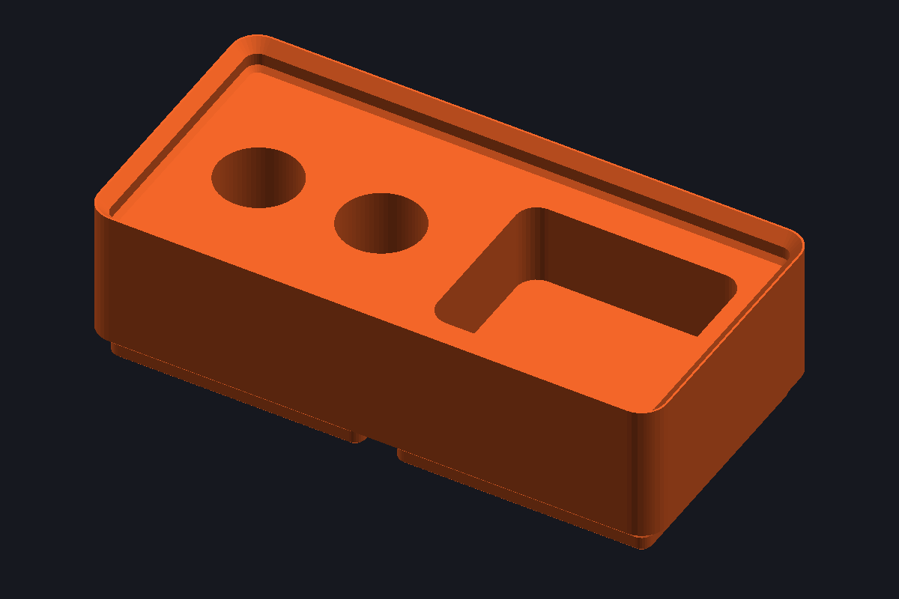

| Half-grid 2×2 bin, underside | Open-frame baseplate |
|---|---|
|  |  |

| Custom 40 × 25 mm cells: 2×1 bin | Custom 40 × 25 mm cells: 2×2 baseplate |
|---|---|
| 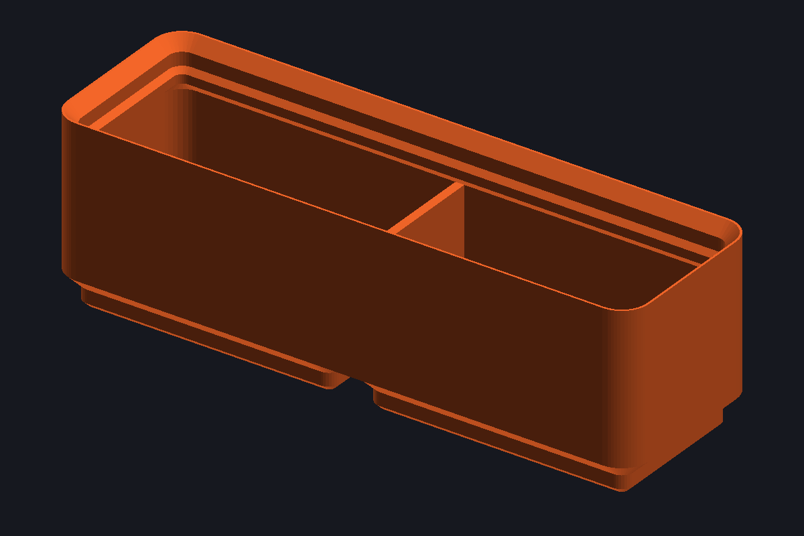 | 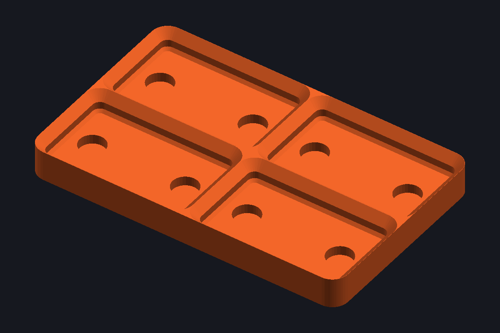 |

| 2×2×6 bin with dividers, 12 mm scoops and label tabs | Cut through: scoop at the front, label tab at the back |
|---|---|
| 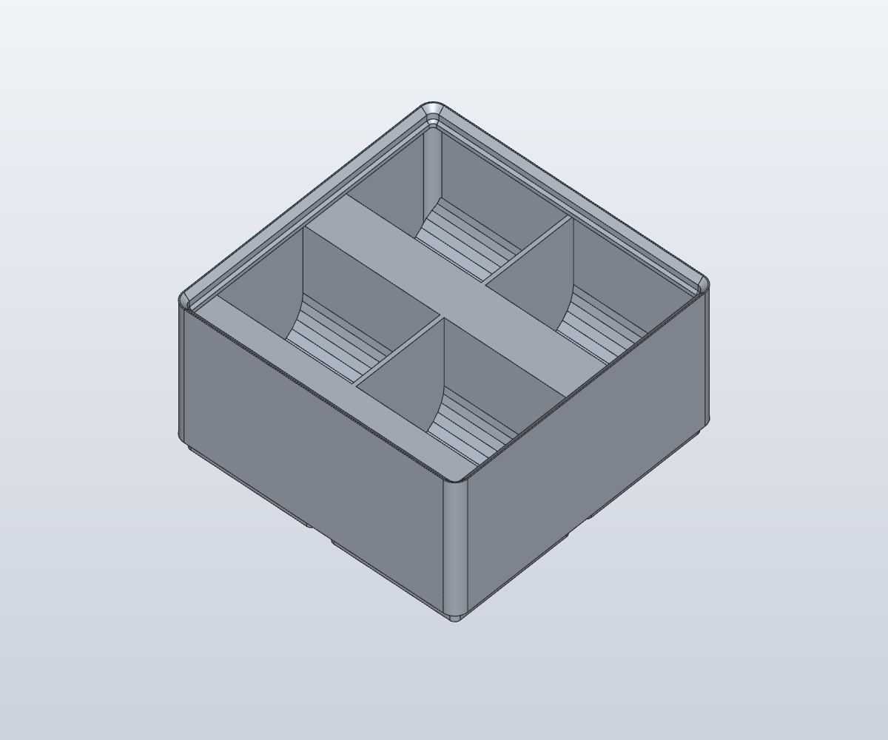 | 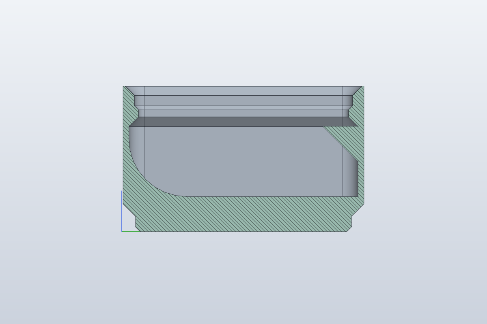 |

| 4×3 baseplate with filler: 12 mm left and right, 25 mm at the back | The baseplate form with the filler fields |
|---|---|
| 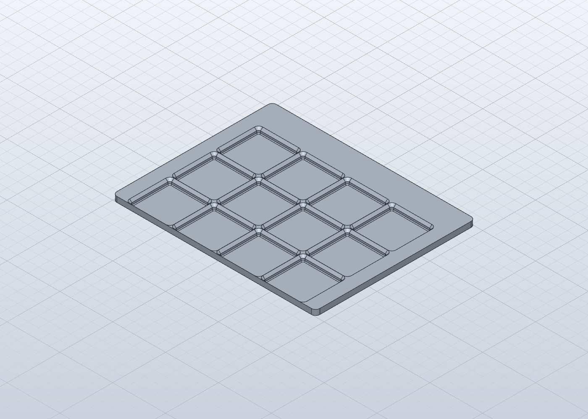 | 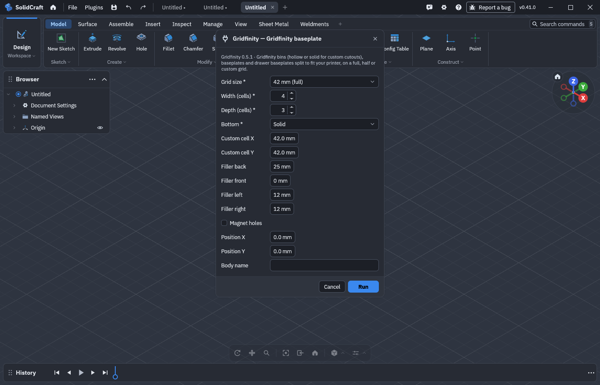 |

| A 400 × 300 mm drawer on a 256 mm printer: four pieces | Dovetails between two pieces, from above and below |
|---|---|
| 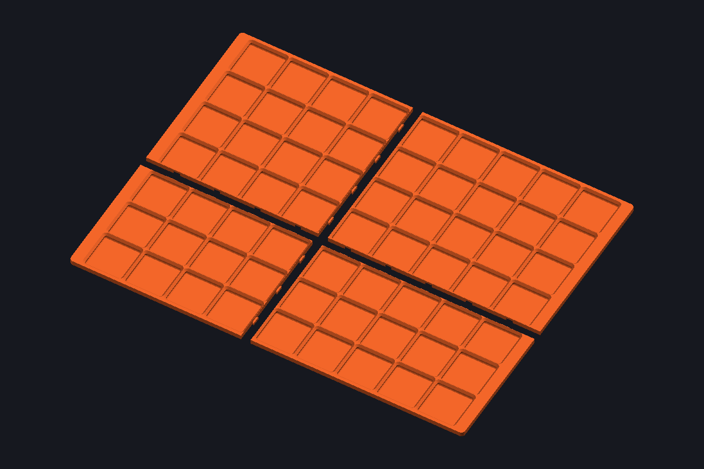 | 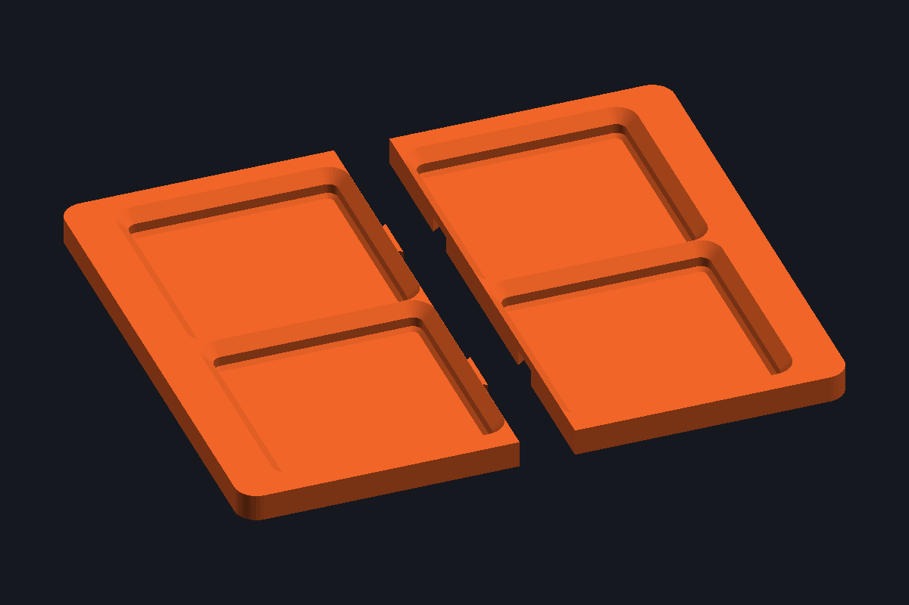 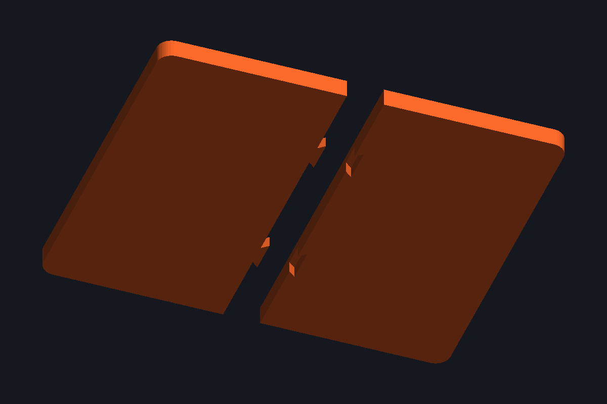 |

Dimensions follow the Gridfinity spec as implemented in gridfinity-rebuilt-openscad
([research/SPEC.md](research/SPEC.md)). Every shape was checked by exporting STL from SolidCraft and
measuring its cross-sections. Not yet printed: please report how it fits.

> Status: early (0.6.0). Tested with SolidCraft 0.41.0, both through scripts/`solidcraft-cli` and in
> the desktop app's plugin dialog. SolidCraft's plugin runtime is itself experimental, so other
> versions may refuse the package.

## Install
Download `gridfinity-0.6.0.zip` from the [latest release](../../releases/latest), then in SolidCraft:
**Plugins › Install plugin…** (or **Preferences › Plugins**) and pick the zip. From a script:

```json
{"commands": [{"command": "plugin.install", "params": {"path": "gridfinity-0.6.0.zip"}}]}
```

Add `"replace": true` to update an installed version. You can also unpack the zip into
`~/.local/share/solidcraft/plugins/` (Linux), `%LOCALAPPDATA%/SolidCraft/plugins` (Windows) or
`~/Library/Application Support/SolidCraft/plugins` (macOS).

## Use it in SolidCraft
Open **Plugins › Gridfinity › Gridfinity bin…**, **Gridfinity baseplate…** or **Gridfinity drawer
baseplate…**, fill in the form and press **Run**. Open a design first: from the start page the form
opens behind it (press Esc to see it). The result is ordinary features in the History bar.

| Plugins menu | The bin form (here a custom 40 × 25 mm grid) |
|---|---|
| 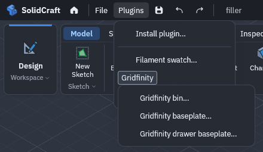 | 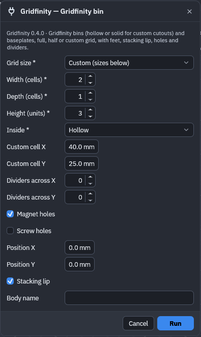 |

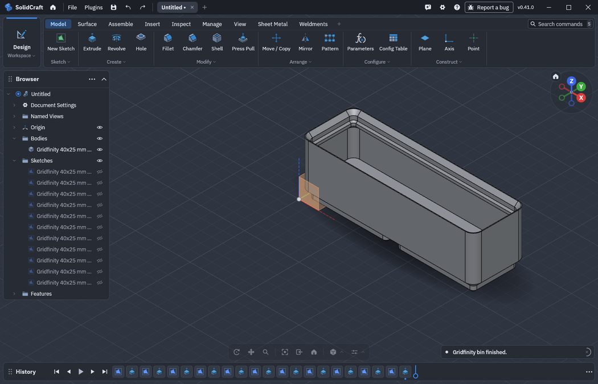

| The drawer baseplate form | Its four pieces in SolidCraft |
|---|---|
| 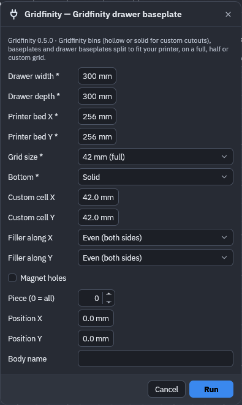 | 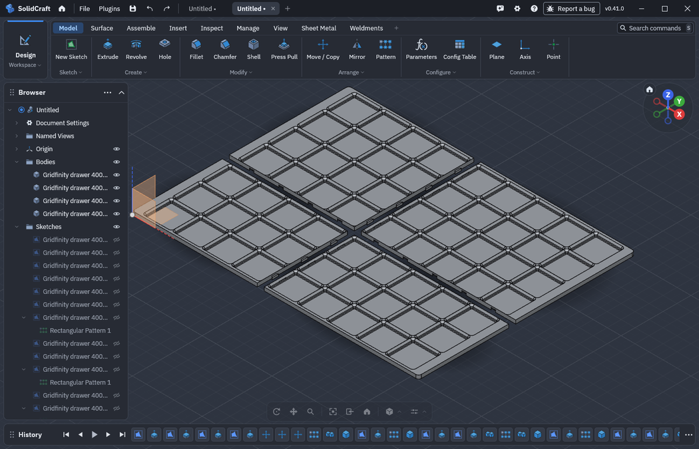 |

### Limits
SolidCraft gives a plugin run 256 commands and 30 seconds. The plugin makes one cell and copies
it, so the number of commands stays small at any size; the time goes on joining the cells, about
0.15 s a cell on a 4-core desktop, more with magnet or screw holes. One run builds up to 100 cells
(a 10 × 10 baseplate in about 16 s), 42 with magnet holes, fewer for bins with screw holes; past
that the plugin says so before it starts. For a bigger baseplate use the drawer baseplate and
build it a piece at a time: set **Piece** to 1, 2, … (numbered along X, then Y) and run once for
each. Pieces built separately land where they would have with the others.

## Run from a script
SolidCraft runs plugin code only when you ask: inspect the package to get its approval hash, then
run an entry with that hash ([examples/](examples/)).

```json
{"commands": [{"command": "plugin.inspect", "params": {"path": "/path/to/plugins/gridfinity"}}]}
```
```json
{"commands": [{"command": "plugin.run", "params": {
  "path": "/path/to/plugins/gridfinity", "approval": "<hash from plugin.inspect>", "entry": "bin",
  "params": {"width": 2, "depth": 1, "height": 3, "holes_magnet": true, "dividers_x": 1}}}]}
```
`solidcraft-cli run bin.json --out bin.stl` builds it and exports an STL.

| Entry | Parameters (default) |
|---|---|
| `bin` | `grid` "42 mm (full)" / "21 mm (half)" / "Custom (sizes below)", `custom_size_x`, `custom_size_y` 15–100 mm (42, Custom only), `width` up to 504 mm and 24 cells (1), `depth` (1), `height` 2–20 units (3), `inside` "Hollow" / "Solid (for custom cutouts)", `dividers_x` 0–10 (0), `dividers_y` 0–10 (0), `holes_magnet` (false), `holes_screw` (false), `inside_scoop` 0–40 mm (0), `inside_label_tab` (false), `position_x`, `position_y` mm (0), `stacking_lip` (true), `title` (body name) |
| `baseplate` | `grid`, `custom_size_x`, `custom_size_y`, `width` (3), `depth` (3), `bottom` "Solid" / "Open (frame only)", `holes_magnet` (false, solid only), `filler_left`, `filler_right`, `filler_front`, `filler_back` 0–200 mm (0), `position_x`, `position_y` mm (0, the corner of the plate with its filler), `title` |
| `drawer` | `drawer_width`, `drawer_depth` 15–1000 mm (300), `printer_x`, `printer_y` 50–1000 mm (256), `grid`, `custom_size_x`, `custom_size_y`, `bottom`, `holes_magnet`, `filler_x` "Even (both sides)" / "Left" / "Right", `filler_y` "Even (both sides)" / "Front" / "Back", `piece` (0: all), `position_x`, `position_y` mm (0), `title` |

Scripts may also say `"full"` / `"half"` / `"custom"` / `"open"` and use the older names `magnets`, `screws`, `name` and `origin: [x, y]`.

Choices that differ slightly from the spec: the stacking lip has a 0.3 mm flat on top instead of a
knife edge, the floor inside a bin is at 6 mm, and baseplate pockets keep a 0.05 mm rim between
them (SolidCraft's kernel can't taper profiles that touch).

## Build
`./build.sh` runs the tests, builds the `wasm32-unknown-unknown` module, wraps it as a component with
`wasm-tools component new` and zips the package into `package/`. Needs Rust with the
`wasm32-unknown-unknown` target and [wasm-tools](https://github.com/bytecodealliance/wasm-tools).

## Layout
- `plugin/` the Rust plugin: `src/geometry.rs` bins and shared shapes, `src/plate.rs` baseplates
  (and why they are built row by row), `src/drawer.rs` splitting a drawer into pieces, `src/lib.rs`
  the entries and the runner; `cargo run --example plan -- drawer '{...}'` prints a plan's commands
- `gen/gridfinity.py` the reference generator (writes SolidCraft command scripts; `gen/reference/`
  holds its output); `gen/volumes.json` the volumes SolidCraft measured for the plugin's shapes,
  which match the generator's; `gen/stlcheck.py` measures an STL, `gen/render.py` makes the
  preview images
- `package/gridfinity/` the plugin package (`plugin.json` + `plugin.wasm`)
- `research/SPEC.md` the dimensions and where they come from

## Licence
MIT, see [LICENSE](LICENSE). `plugin/wit/plugin.wit` is SolidCraft's plugin interface (Apache-2.0);
see [NOTICE](NOTICE).
