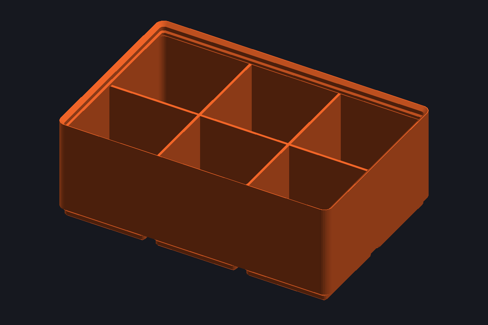
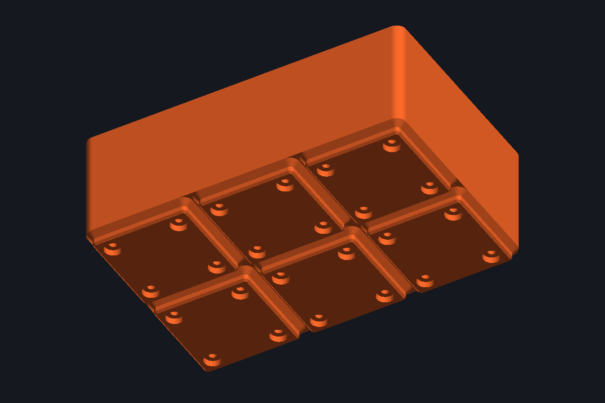
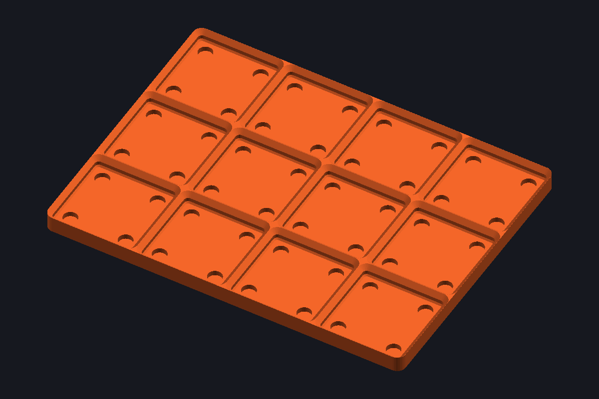
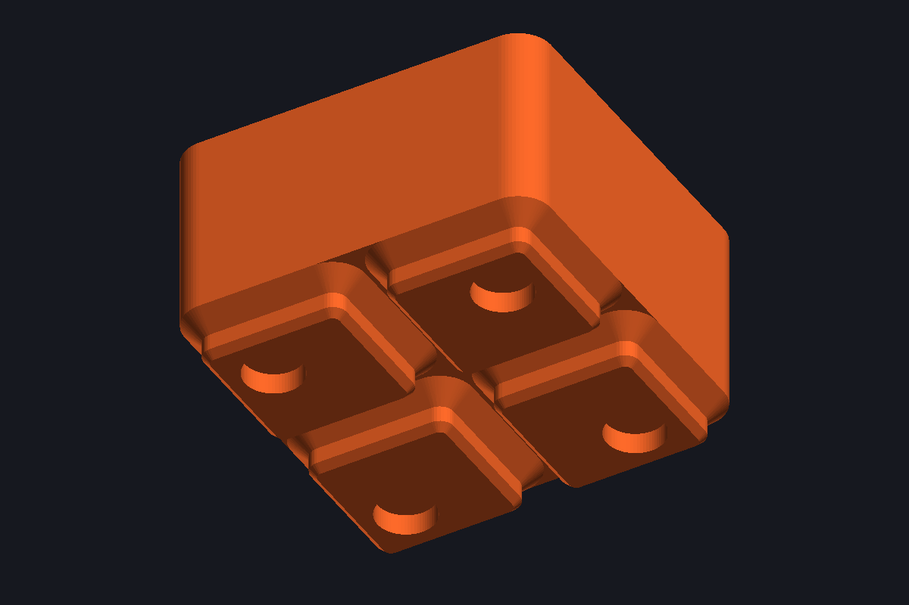
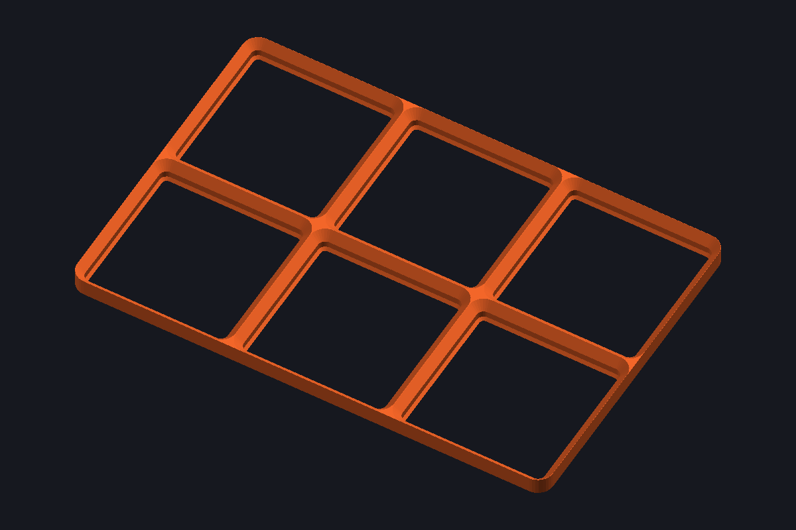

# Gridfinity for SolidCraft

A [SolidCraft](https://github.com/tangency-labs/solidcraft) plugin that makes
[Gridfinity](https://gridfinity.xyz) bins and baseplates. The result is ordinary SolidCraft features:
one undo step, editable afterwards, and they keep working without the plugin.



| Underside: feet with magnet and screw holes | 4×3 baseplate with magnet holes |
|---|---|
|  |  |

- **bin**: width × depth cells, height in units (7 mm), Gridfinity feet, 0.95 mm walls,
  stacking lip, optional magnet holes (6.5 × 2.4 mm), screw holes (3 mm) and dividers.
  Full grid (42 mm cells) or **half grid** (21 mm cells: four feet fit one baseplate pocket; magnet
  holes sit on the same spots as a full-grid baseplate's magnets).
- **baseplate**: width × depth pockets with the Gridfinity profile, full or half grid, a solid
  bottom (optional magnet holes) or an **open frame** (no bottom).

| Half-grid 2×2 bin, underside | Open-frame baseplate |
|---|---|
|  |  |

Dimensions follow the Gridfinity spec as implemented in gridfinity-rebuilt-openscad
([research/SPEC.md](research/SPEC.md)). Every shape was checked by exporting STL from SolidCraft and
measuring its cross-sections. Not yet printed: please report how it fits.

> Status: early (0.2.0). Tested with SolidCraft 0.41.0 through scripts/`solidcraft-cli`; the desktop
> app's plugin dialog shows the form (Plugins menu › Gridfinity bin / baseplate). SolidCraft's plugin runtime is itself experimental, so other
> versions may refuse the package.

## Install
Download `gridfinity-0.2.0.zip` from the [latest release](../../releases/latest), then in SolidCraft:
**Preferences › Plugins › Install plugin…** and pick the zip. From a script:

```json
{"commands": [{"command": "plugin.install", "params": {"path": "gridfinity-0.2.0.zip"}}]}
```

Add `"replace": true` to update an installed version. You can also unpack the zip into
`~/.local/share/solidcraft/plugins/` (Linux), `%LOCALAPPDATA%/SolidCraft/plugins` (Windows) or
`~/Library/Application Support/SolidCraft/plugins` (macOS).

## Run
SolidCraft runs plugin code only when you ask: inspect the package to get its approval hash, then
run an entry with that hash ([examples/](examples/)).

```json
{"commands": [{"command": "plugin.inspect", "params": {"path": "/path/to/plugins/gridfinity"}}]}
```
```json
{"commands": [{"command": "plugin.run", "params": {
  "path": "/path/to/plugins/gridfinity", "approval": "<hash from plugin.inspect>", "entry": "bin",
  "params": {"width": 2, "depth": 1, "height": 3, "holes_magnet": true, "dividers_x": 1}}}]}
```
`solidcraft-cli run bin.json --out bin.stl` builds it and exports an STL.

| Entry | Parameters (default) |
|---|---|
| `bin` | `grid` "42 mm (full)" / "21 mm (half)", `width` 1–12 full or 1–24 half (1), `depth` (1), `height` 2–20 units (3), `dividers_x` 0–10 (0), `dividers_y` 0–10 (0), `holes_magnet` (false), `holes_screw` (false), `position_x`, `position_y` mm (0), `stacking_lip` (true), `title` (body name) |
| `baseplate` | `grid`, `width` (3), `depth` (3), `bottom` "Solid" / "Open (frame only)", `holes_magnet` (false, solid only), `position_x`, `position_y` mm (0), `title` |

Scripts may also say `"full"` / `"half"` / `"open"` and use the older names `magnets`, `screws`, `name` and `origin: [x, y]`.

Choices that differ slightly from the spec: the stacking lip has a 0.3 mm flat on top instead of a
knife edge, the floor inside a bin is at 6 mm, and baseplate pockets keep a 0.05 mm rim between
them (SolidCraft's kernel can't taper profiles that touch).

## Build
`./build.sh` runs the tests, builds the `wasm32-unknown-unknown` module, wraps it as a component with
`wasm-tools component new` and zips the package into `package/`. Needs Rust with the
`wasm32-unknown-unknown` target and [wasm-tools](https://github.com/bytecodealliance/wasm-tools).

## Layout
- `plugin/` the Rust plugin; `src/geometry.rs` has the geometry, `src/lib.rs` the entries
- `gen/gridfinity.py` the reference generator the plugin is tested against (writes SolidCraft
  command scripts; `gen/reference/` holds its output); `gen/stlcheck.py` measures an STL,
  `gen/render.py` makes the preview images
- `package/gridfinity/` the plugin package (`plugin.json` + `plugin.wasm`)
- `research/SPEC.md` the dimensions and where they come from

## Licence
MIT, see [LICENSE](LICENSE). `plugin/wit/plugin.wit` is SolidCraft's plugin interface (Apache-2.0);
see [NOTICE](NOTICE).
